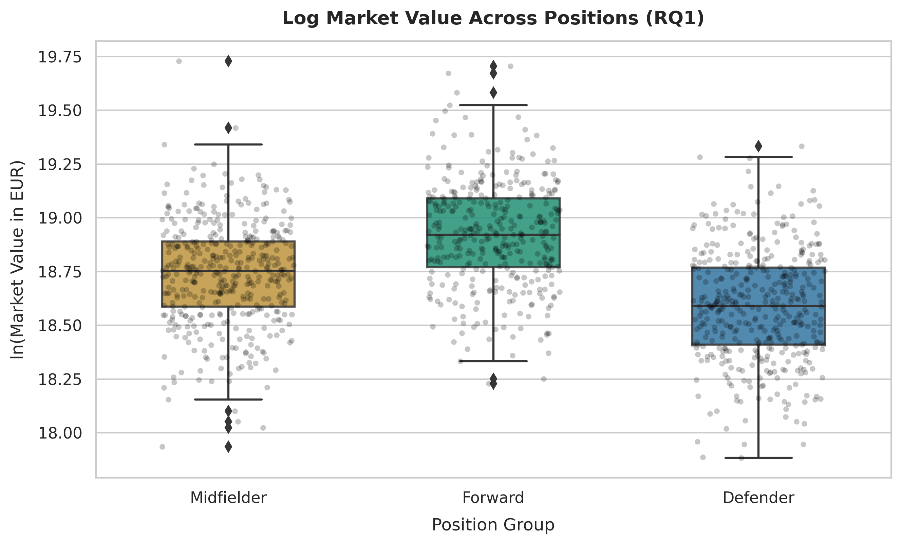
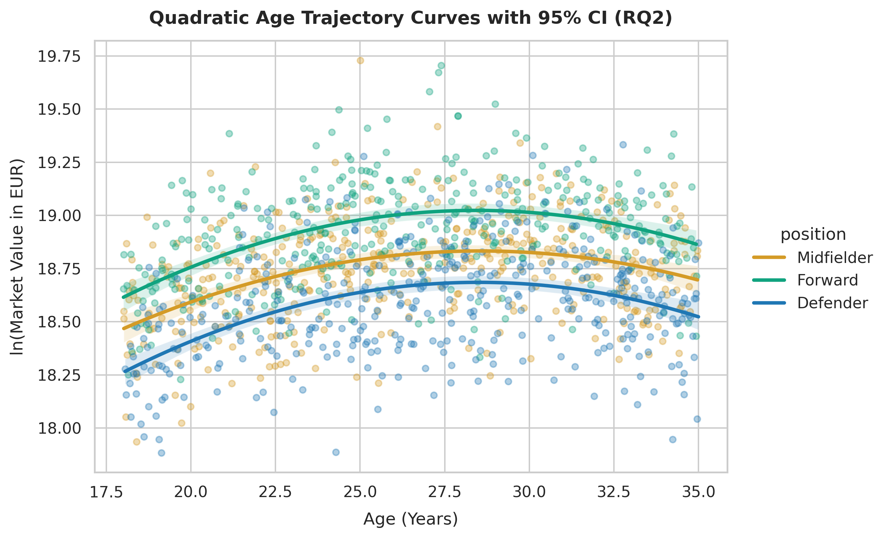
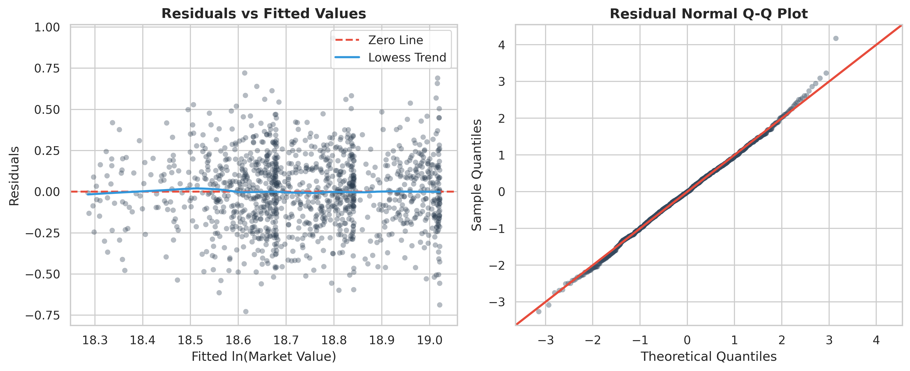

# Econometric & Machine Learning Valuation of European Big-5 Football Players

**Course:** Data Analysis & Econometric Modeling (Task 3)  
**Dataset:** `big5_players_data.csv` ($N = 1,200$ outfield players, $\ge 90$ minutes played)  
**Methodology:** Log-Linear Quadratic OLS (`HC1` Robust SE) & 5-Fold Cross-Validation ML Benchmarking

---

## 1. Executive Summary & Key Empirical Findings

This repository investigates the structural, demographic, and on-pitch performance determinants of football player market valuations across Europe's Big-5 leagues (EPL, La Liga, Bundesliga, Serie A, Ligue 1). Using a cleaned sample of **$N = 1,200$ players** (431 Defenders, 407 Midfielders, 362 Forwards), we evaluate three core research questions:

1. **Positional Valuation Premiums (RQ1):** Controlling for age, playing time, remaining contract duration, club tier, and league fixed effects, **Forwards command a $+74.16\%$ market value premium** ($\gamma = 0.5548, p < 0.001$) and **Midfielders command a $+40.49\%$ premium** ($\gamma = 0.3400, p < 0.001$) relative to Defenders. Adding tactical position improves Adjusted $R^2$ from $0.8007$ to $0.8432$ and reduces AIC by $285.5$ points.
2. **Quadratic Age Trajectories (RQ2):** Market valuation follows a statistically significant concave (inverted-U) age trajectory across all positions ($\beta_{\text{age}^2} < 0, p < 0.0001$). Unconstrained quadratic vertices occur at **$37.94$ years** for Midfielders, **$38.58$ years** for Defenders, and **$39.03$ years** for Forwards, reflecting strong valuation retention among veteran players when minutes played and contract length are held constant.
3. **Position-Specific Performance Metrics (RQ3):** Once structural factors (club tier, minutes played, contract years, age) are controlled, single-season per-90 micro-metrics—`xg_per90` for Forwards ($p = 0.3896$), `prog_passes_per90` for Midfielders ($p = 0.6139$), and `tackles_per90` for Defenders ($p = 0.6750$)—do not yield statistically significant marginal explanatory gains ($\Delta \text{Adj } R^2 \le 0.0003$).

---

## 2. Model Evaluation Benchmark (5-Fold Cross-Validation)

All models are evaluated on out-of-fold predictions back-transformed to Euros ($\hat{y}_i = \exp(\hat{z}_i)$) across 5 shuffled folds (`random_state=42`):

| Model | MAE (€M) | RMSE (€M) | MAPE (%) | Adjusted $R^2$ | Inference Latency (ms) |
| :--- | :---: | :---: | :---: | :---: | :---: |
| **OLS Regression** | **$24.81 \pm 1.00$** | **$42.49 \pm 3.55$** | **$32.5\%$** | **$0.828$** | $7.9$ |
| **Ridge Regression ($\lambda=1.5$)** | $25.11 \pm 1.30$ | $43.08 \pm 3.83$ | $32.8\%$ | $0.825$ | **$6.6$** |
| **XGBoost** | $26.86 \pm 1.15$ | $46.39 \pm 5.00$ | $36.1\%$ | $0.793$ | $10.5$ |
| **LightGBM** | $27.17 \pm 1.26$ | $46.28 \pm 4.82$ | $35.9\%$ | $0.793$ | $13.6$ |
| **Random Forest** | $27.88 \pm 0.93$ | $48.41 \pm 5.23$ | $37.5\%$ | $0.772$ | $63.6$ |

**Key Benchmark Takeaway:** Parametric **OLS Regression** outperforms gradient-boosted trees (XGBoost, LightGBM) and Random Forest by **€2.05M–€3.07M in MAE** and **$+0.035$ to $+0.056$ in Adjusted $R^2$**, demonstrating that the log-quadratic functional form accurately captures the underlying data-generating process without overfitting finite sample noise.

---

## 3. Repository Architecture

    ├── data/
    │   ├── raw/
    │   │   └── big5_players_data.csv                     # Original raw dataset (N = 1,200)
    │   └── processed/
    │       ├── cleaned_players_data.csv                  # Cleaned data with log transforms & centered age
    │       ├── metrics_summary.csv                       # Positional descriptive statistics (Table 1)
    │       └── model_benchmarks.csv                      # 5-Fold CV model comparison metrics (Table 2)
    ├── docs/
    │   └── domain_model.md                               # Mathematical formulation & notation specification
    ├── notebooks/
    │   ├── notebooks_01_data_analysis.ipynb              # EDA, cleaning, Table 1, Figures 1 & 2
    │   ├── notebooks_02_econometric_modeling.ipynb       # RQ1–RQ3 regressions & Figure 3
    │   └── notebooks_03_diagnostics_and_robustness.ipynb # Breusch-Pagan, VIF, Figure 4 & 5-Fold CV
    ├── reports/
    │   └── figures/                                      # High-resolution (300 DPI) PNG & PDF plots
    │       ├── fig1_mv_distribution.(png|pdf)
    │       ├── fig2_position_boxplot.(png|pdf)
    │       ├── fig3_age_valuation_curves.(png|pdf)
    │       └── fig4_residual_diagnostics.(png|pdf)
    ├── src/
    │   ├── process_data.py                               # Modular data cleaning & aggregation functions
    │   └── visualize.py                                  # Publication-grade plotting utilities
    └── requirements.txt                                  # Reproducible Python environment dependencies

---

## 4. Visual Artifacts Summary

### Figure 1: Market Value Distribution (Raw vs. Log-Transformed)
Contrasts right-skewed raw market values (€M) against the approximately symmetric natural-log distribution $\ln(\text{Market Value})$.

### Figure 2: Log Market Value by Tactical Position
Illustrates median and interquartile dispersion of $\ln(\text{Market Value})$ across Forwards (median €75.40M), Midfielders (median €57.33M), and Defenders (median €44.01M).

### Figure 3: Quadratic Age Valuation Curves
Displays quadratic age valuation curves with 95% confidence intervals stratified by tactical position.

### Figure 4: OLS Residual & Normality Diagnostics
Validates OLS residual homoskedasticity (Breusch-Pagan $\text{LM} = 12.73, p = 0.6233$) and near-normal Q-Q alignment.

