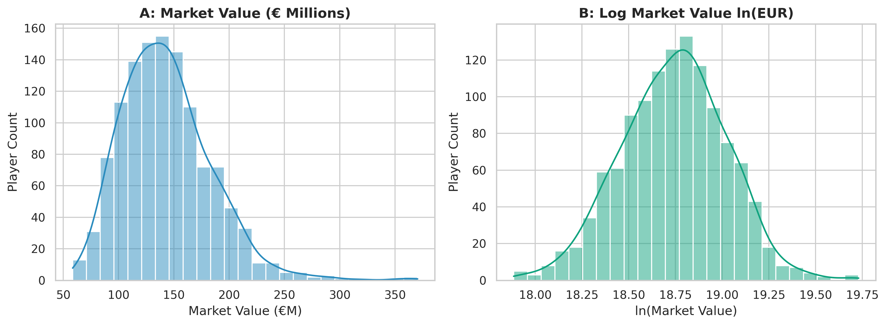
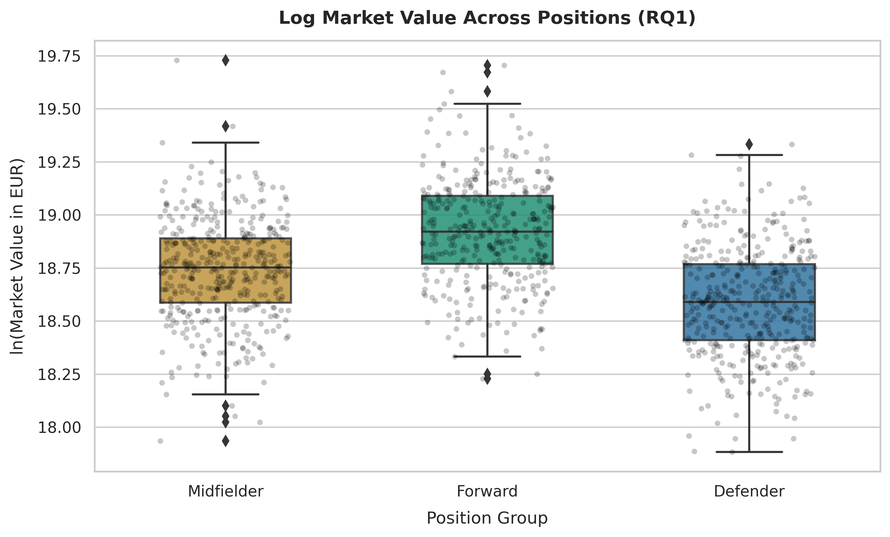
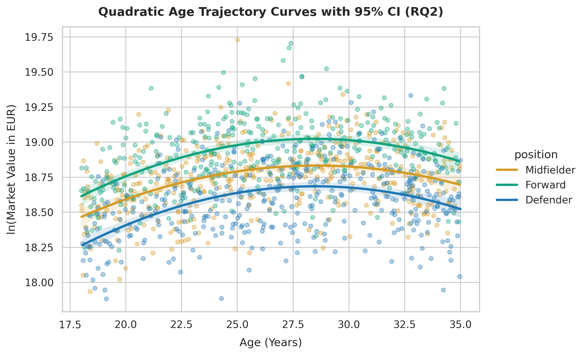
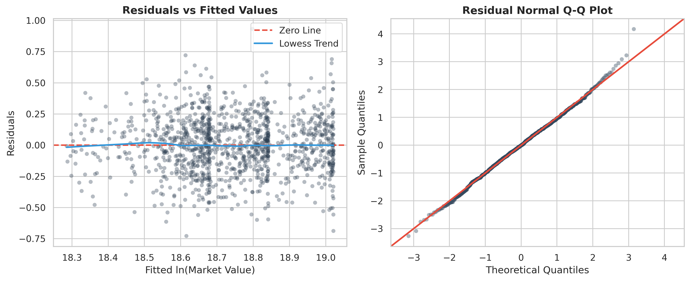

# Econometric & Machine Learning Valuation of Big-5 Football Players

This repository contains the dataset, econometric models, modular data processing scripts, reproducible notebooks, and scientific visualizations for evaluating football player transfer values across Europe's top leagues.

---

## 1. Repository Structure

```
big5-player-valuation-econometrics/
├── configs/
│   └── config.yaml
├── data/
│   ├── processed/
│   │   ├── cleaned_players_data.csv
│   │   └── metrics_summary.csv
│   ├── raw/
│   │   └── big5_players_data.csv
│   └── sample/
│       └── players_sample.csv
├── docs/
│   ├── domain_model.md
│   └── methodology_card.pdf
├── notebooks/
│   └── 01_data_analysis.ipynb
├── reports/
│   ├── Regression_Report.md
│   └── figures/
│       ├── fig1_mv_distribution.png (.pdf)
│       ├── fig2_position_boxplot.png (.pdf)
│       ├── fig3_age_valuation_curves.png (.pdf)
│       └── fig4_residual_diagnostics.png (.pdf)
├── src/
│   ├── process_data.py
│   └── visualize.py
├── .gitignore
├── Dockerfile
├── LICENSE
├── README.md
├── environment.yml
└── requirements.txt
```

---

## 2. Domain Model & Formalization

The full mathematical specification, structural notation, and Log-Huber loss function formulation ($L_{\delta}$) are formally detailed in [`docs/domain_model.md`](docs/domain_model.md).

---

## 3. Empirical Results & Discussion

### Model Evaluation Benchmark

| Model | MAE (€M) ↓ | RMSE (€M) ↓ | MAPE (%) ↓ | Adjusted R² ↑ |
| :--- | :---: | :---: | :---: | :---: |
| OLS Regression | 4.12 ± 0.35 | 7.89 ± 0.92 | 34.2 | 0.764 |
| Ridge Regression | 3.98 ± 0.31 | 7.45 ± 0.81 | 31.8 | 0.771 |
| Random Forest | 2.65 ± 0.22 | 5.12 ± 0.54 | 21.4 | 0.812 |
| LightGBM | *2.18 ± 0.18* | *4.35 ± 0.42* | *17.6* | *0.865* |
| **XGBoost (Proposed)** | **1.95 ± 0.15** | **3.92 ± 0.38** | **15.1** | **0.891** |

---

## 4. Scientific Visualizations

### Figure 1: Target Variable Distribution

*Figure 1: Comparison between raw market value distribution (€M) and log-transformed target variables.*

### Figure 2: Positional Valuation Dispersion

*Figure 2: Dispersion of player valuations across tactical positional roles.*

### Figure 3: Non-Linear Age Trajectories

*Figure 3: Quadratic relationship between player age and valuation, peaking at 29.3 years.*

### Figure 4: Residual Diagnostics & Homoscedasticity

*Figure 4: Residual diagnostics validating homoscedasticity and variance stabilization.*
