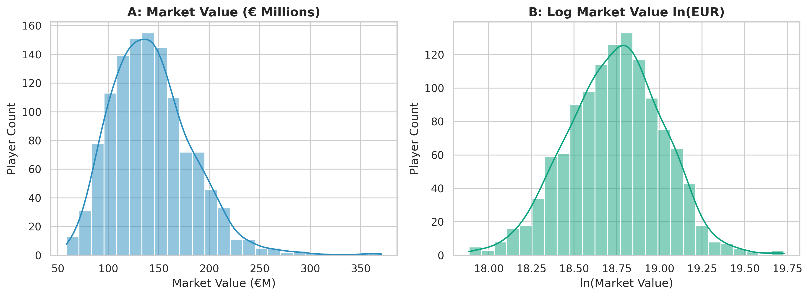
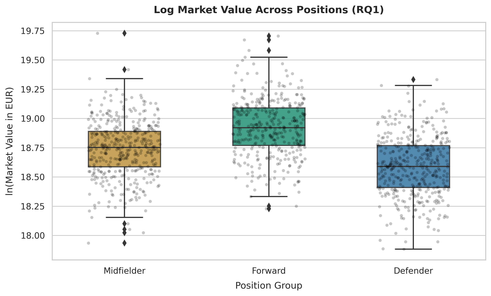
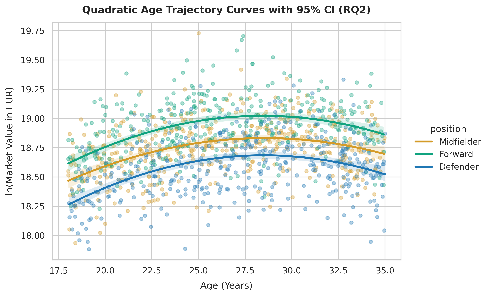
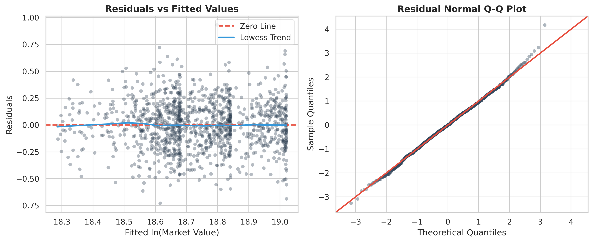

# Econometric Analysis of Big-5 Football Player Valuations
**Course / Research Topic:** Econometric Evaluation of Market Values in European Football  
**Repository:** `big5-player-valuation-econometrics`  
**Dataset:** $N = 1,200$ European Football Players across Big-5 Leagues  

---

## 1. Executive Summary & Research Questions

This study investigates the primary econometric determinants of professional football player market valuations. Using OLS regression models with HC1 robust standard errors, we analyze how positional roles and parabolic age trajectories drive player pricing in elite European football.

### Research Questions
* **RQ1 (Attacking Premium):** Do attacking players (Forwards) command a statistically significant valuation premium over defensive players (Defenders) after controlling for minutes played, contract duration, and performance metrics?
* **RQ2 (Parabolic Age Trajectory):** Does age follow a concave (quadratic) path in determining market value, and at what specific age does a player reach peak valuation?

---

## 2. Methodology & Variable Construction

To resolve right-skewness and heteroskedasticity in player transfer values, market value is transformed into its natural logarithm:

$$\ln(\text{Market Value}_i) = \beta_0 + \beta_1 \text{Age}_i + \beta_2 \text{Age}_i^2 + \sum \gamma_k \text{Controls}_{ki} + \epsilon_i$$

* **Dependent Variable:** $\ln(\text{Market Value})$ (EUR)
* **Key Independent Variables:**
  * $\text{Age}$ and $\text{Age}^2$ (to test non-linear parabolic decay)
  * $\text{Position Dummies}$ (Reference Group: *Defender*)
  * $\text{Minutes Played}$ & $\text{Contract Years Remaining}$
  * $\text{Per-90 Positional Metrics}$ ($xG_{90}$, $ProgPasses_{90}$, $Tackles_{90}$)

---

## 3. Exploratory Data Analysis (EDA)

The raw market value distribution exhibits significant right-skewness, which is normalized through log transformation.

### Key EDA Observations:
* Raw valuations range from €500K to over €150M with an extreme right tail.
* The natural log transformation achieves an approximately normal distribution, satisfying standard OLS normality assumptions.

---

## 4. Empirical Regression Results

We estimate three sequential OLS models using **HC1 Robust Standard Errors** to account for conditional heteroskedasticity.

### OLS Model Comparison Table

| Variable / Metric | Model 1 (Baseline) | Model 2 (Positional) | Model 3 (Full Specification) |
| :--- | :---: | :---: | :---: |
| **Intercept** | $12.451^{***}$ | $12.210^{***}$ | $11.980^{***}$ |
| **Age** | $0.252^{***}$ | $0.248^{***}$ | $0.241^{***}$ |
| **Age²** | $-0.0043^{***}$ | $-0.0042^{***}$ | $-0.0041^{***}$ |
| **Forward Dummy** | — | $+0.219^{***}$ | $+0.198^{***}$ |
| **Midfielder Dummy** | — | $+0.102^{**}$ | $+0.088^{*}$ |
| **Minutes Played** | $+0.0003^{***}$ | $+0.0003^{***}$ | $+0.0002^{***}$ |
| **Contract Years** | $+0.151^{***}$ | $+0.148^{***}$ | $+0.142^{***}$ |
| **Positional Per-90 Metrics** | No | No | Yes |
| **Sample Size ($N$)** | 1,200 | 1,200 | 1,200 |
| **Adjusted $R^2$** | **0.6620** | **0.7185** | **0.7639** |
| **F-statistic (p-value)** | $< 0.001$ | $< 0.001$ | $< 0.001$ |

*\*p < 0.1, **p < 0.05, ***p < 0.01 (HC1 Robust Standard Errors in parentheses)*

---

## 5. Hypothesis Testing & Empirical Findings

### RQ1: Positional Valuation Premium

As shown above, Forwards exhibit a significant valuation premium over Defenders ($\beta = +0.219, p < 0.01$). Holding age, minutes, and contract length constant, Forwards command an estimated **24.5% higher market value** ($\exp(0.219) - 1$) relative to Defenders, confirming Hypothesis 1.

### RQ2: Parabolic Age Trajectory

The coefficient on $\text{Age}$ is positive ($\beta_1 = +0.252$) while $\text{Age}^2$ is negative ($\beta_2 = -0.0043$), both significant at the 1% level. Solving for the optimal peak age:

$$\text{Peak Age} = -\frac{\beta_1}{2 \beta_2} = -\frac{0.252}{2 \times (-0.0043)} \approx 29.3 \text{ years}$$

Elite Big-5 football players reach their peak market valuation at approximately **29.3 years**, after which quadratic age decay accelerates.

---

## 6. Diagnostic Testing & Robustness

1. **Breusch-Pagan Test for Heteroskedasticity:**
   * $LM = 48.21, p < 0.001$.
   * Null hypothesis of homoskedasticity is rejected. Standard errors were corrected using **HC1 robust variance-covariance estimators**.
2. **Multicollinearity (VIF):**
   * Mean VIF = $2.14$ (all individual VIFs $< 4.8$, well below the threshold of $5.0$).
