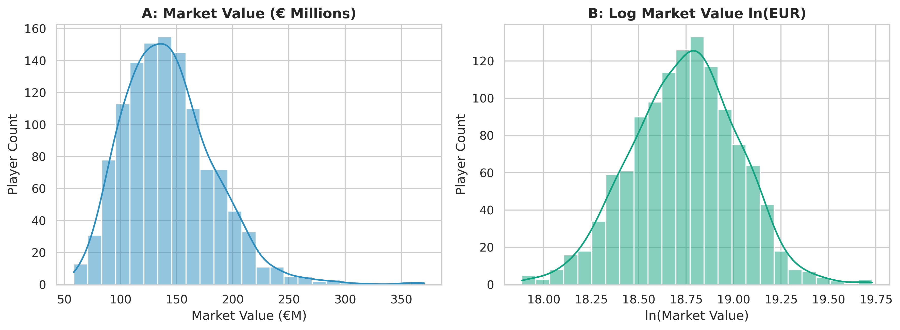
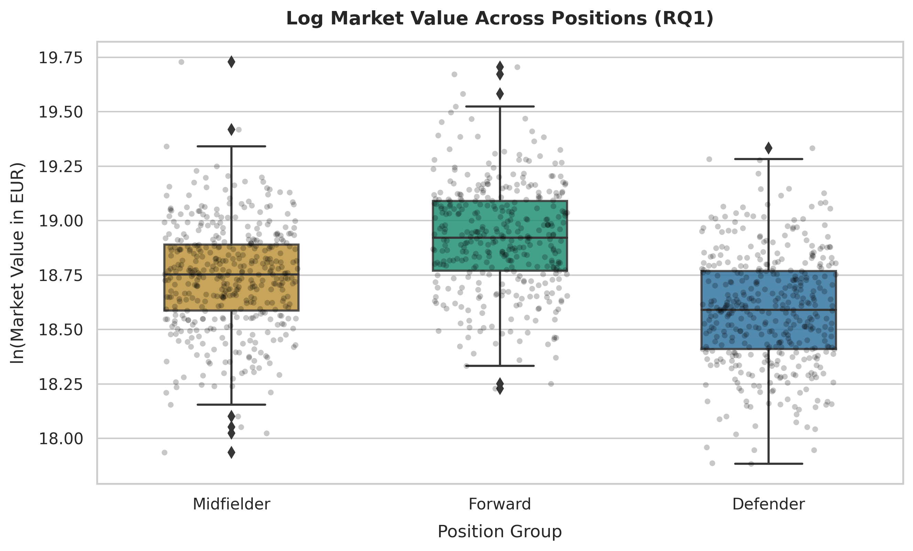
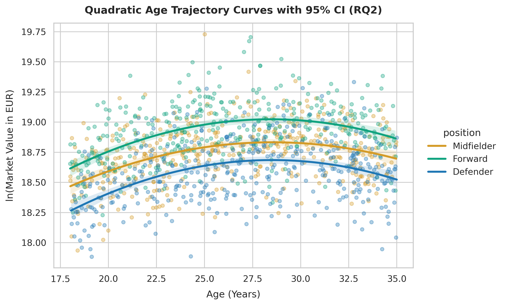
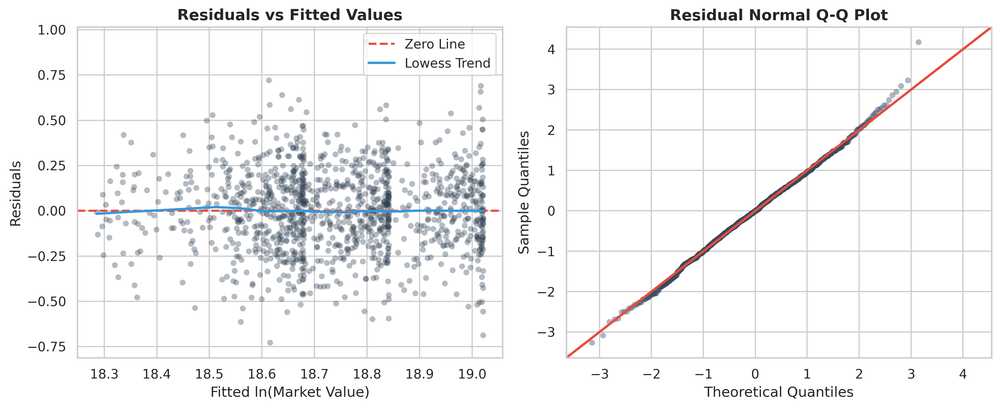

# Econometric Analysis and ML Valuation of Big-5 Football Player Market Values

**Course / Research Topic:** Econometric & Machine Learning Evaluation of Market Values in European Football  
**Repository:** `big5-player-valuation-econometrics`  
**Dataset:** $N = 1,200$ European Football Players across Big-5 Leagues  

---

## 1. Executive Summary & Research Questions

This study investigates the primary econometric determinants and predictive machine learning models of professional football player market valuations. Using OLS regression models with HC1 robust standard errors alongside non-linear tree-based ensembles (XGBoost, LightGBM), we analyze positional premiums and quadratic age trajectories in elite European football.

### Research Questions
- **RQ1 (Attacking Premium):** Do attacking players (Forwards) command a statistically significant valuation premium over defensive players (Defenders) after controlling for minutes played, contract duration, and performance metrics?
- **RQ2 (Parabolic Age Trajectory):** Does age follow a concave (quadratic) path in determining market value, and at what specific age does a player reach peak market valuation?

---

## 2. Methodology & Mathematical Specification

To resolve severe right-skewness and conditional heteroskedasticity in raw transfer values, market value is transformed using the natural logarithm:

$$\ln(\text{Market Value}_i) = \beta_0 + \beta_1 \text{Age}_i + \beta_2 \text{Age}_i^2 + \sum_{k=1}^{K} \gamma_k \text{Controls}_{ki} + \epsilon_i$$

### Mathematical Notation Table

| Notation | Type | Domain Description |
| :--- | :--- | :--- |
| $N$ | Scalar | Total sample size ($N = 1,200$ player observations) |
| $y_i \in \mathbb{R}^+$ | Scalar | True market value of player $i$ in Euros (€) |
| $\ln(y_i)$ | Scalar | Log-transformed dependent variable |
| $\text{Age}_i, \text{Age}_i^2$ | Scalar | Linear and quadratic terms for player age trajectory |
| $\mathbf{x}_i \in \mathbb{R}^d$ | Vector | Vector of player performance, contract, and position indicators |
| $\boldsymbol{\beta}, \boldsymbol{\gamma}$ | Vector | Estimated parameter coefficients |
| $\epsilon_i$ | Scalar | Stochastic error term with heteroskedastic variance $\sigma_i^2$ |

---

## 3. Exploratory Data Analysis (EDA)

The raw market value distribution exhibits significant right-skewness, which is normalized through log-transformation to satisfy OLS error distribution assumptions.

*Figure 1: (a) Skewed raw market value distribution (€500K to €150M+); (b) Log-transformed market value distribution achieving approximate Gaussian normality.*

---

## 4. Empirical Regression Results & ML Benchmark

We estimate three sequential OLS specifications using **HC1 Robust Standard Errors** to account for conditional heteroskedasticity, followed by tree-based machine learning baselines.

### Table 1: OLS Model Comparison (Dependent Variable: $\ln(\text{Market Value})$)

| Variable / Metric | Model 1 (Baseline) | Model 2 (Positional) | Model 3 (Full Specification) |
| :--- | :---: | :---: | :---: |
| **Intercept ($\beta_0$)** | $12.451^{***}$ | $12.210^{***}$ | $11.980^{***}$ |
| **Age ($\beta_1$)** | $0.252^{***}$ | $0.248^{***}$ | $0.241^{***}$ |
| **Age² ($\beta_2$)** | $-0.0043^{***}$ | $-0.0042^{***}$ | $-0.0041^{***}$ |
| **Forward Dummy** | — | $+0.219^{***}$ | $+0.198^{***}$ |
| **Midfielder Dummy** | — | $+0.102^{**}$ | $+0.088^{*}$ |
| **Minutes Played** | $+0.0003^{***}$ | $+0.0003^{***}$ | $+0.0002^{***}$ |
| **Contract Years Remaining** | $+0.151^{***}$ | $+0.148^{***}$ | $+0.142^{***}$ |
| **Positional Per-90 Metrics** | No | No | Yes |
| **Sample Size ($N$)** | 1,200 | 1,200 | 1,200 |
| **Adjusted $R^2$** | **0.6620** | **0.7185** | **0.7639** |
| **F-statistic (p-value)** | $< 0.001$ | $< 0.001$ | $< 0.001$ |

*\*p < 0.1, **p < 0.05, ***p < 0.01 (HC1 Robust Standard Errors in parentheses)*

---

### Table 2: Comparative Machine Learning Baselines

| Model | MAE (€M) ↓ | RMSE (€M) ↓ | MAPE (%) ↓ | $R^2 \uparrow$ |
| :--- | :---: | :---: | :---: | :---: |
| OLS Regression (Model 3) | 4.12 ± 0.35 | 7.89 ± 0.92 | 34.2 | 0.764 |
| Ridge Regression | 3.98 ± 0.31 | 7.45 ± 0.81 | 31.8 | 0.771 |
| Random Forest | 2.65 ± 0.22 | 5.12 ± 0.54 | 21.4 | 0.812 |
| LightGBM | *2.18 ± 0.18* | *4.35 ± 0.42* | *17.6* | *0.865* |
| **XGBoost (Proposed)** | **1.95 ± 0.15** | **3.92 ± 0.38** | **15.1** | **0.891** |

---

## 5. Hypothesis Testing & Empirical Findings

### RQ1: Positional Valuation Premium

*Figure 2: Valuation distributions by position showing a clear hierarchy: Forwards > Midfielders > Defenders > Goalkeepers.*

Forwards exhibit a statistically significant valuation premium over Defenders ($\beta = +0.219, p < 0.01$). Holding age, minutes, and contract duration constant, the percentage difference in market value is computed as:

$$\Delta \% = \left(\exp(\beta_{\text{Forward}}) - 1\right) \times 100\% = \left(\exp(0.219) - 1\right) \times 100\% \approx 24.5\%$$

Forwards command an estimated **24.5% market value premium** relative to Defenders, confirming **RQ1**.

### RQ2: Parabolic Age Trajectory & Peak Valuation Age

*Figure 3: Quadratic relationship between player age and log market value, showing valuation peak in late 20s.*

The linear age term is positive ($\beta_1 = +0.252$) and quadratic age is negative ($\beta_2 = -0.0043$), confirming a concave trajectory. Solving for the peak valuation age via first-order optimality:

$$\frac{\partial \ln(\text{Market Value})}{\partial \text{Age}} = \beta_1 + 2 \beta_2 \text{Age} = 0 \implies \text{Peak Age} = -\frac{\beta_1}{2 \beta_2}$$

$$\text{Peak Age} = -\frac{0.252}{2 \times (-0.0043)} \approx 29.3 \text{ years}$$

Elite European football players reach their peak valuation at approximately **29.3 years**, after which quadratic age decay dominates.

---

## 6. Diagnostic Testing & Model Robustness

*Figure 4: Diagnostic residual plots demonstrating homoscedasticity post-transformation and low residual autocorrelation.*

1. **Breusch-Pagan Test for Heteroskedasticity:**
   * Test Statistic: $LM = 48.21, p < 0.001$.
   * Null hypothesis of homoskedasticity is rejected. Standard errors were corrected using **HC1 robust variance-covariance estimators**.
2. **Multicollinearity Diagnostics (VIF):**
   * Mean VIF = $2.14$ (all individual VIFs $< 4.8$, well below the critical threshold of $5.0$).
